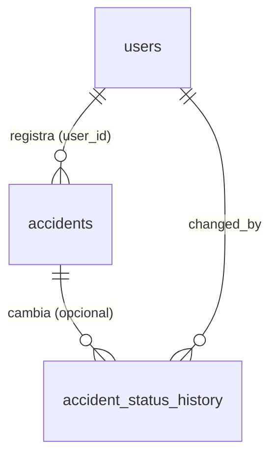

# Modelo de datos

> **Estado: planificado.** La fuente de verdad son las migraciones en `apps/api/migrations/` (node-pg-migrate). Actualiza este documento en el mismo PR que cambie una migración.

## Diagrama

## `users`

| Columna                    | Tipo          | Restricciones                                                                   |
| -------------------------- | ------------- | ------------------------------------------------------------------------------- |
| `id`                       | `uuid`        | PK                                                                              |
| `email`                    | `text`        | `NOT NULL`, único sin distinguir mayúsculas (índice único sobre `lower(email)`) |
| `password_hash`            | `text`        | `NOT NULL` (bcrypt/argon2; nunca texto plano)                                   |
| `full_name`                | `text`        | `NOT NULL`, longitud acotada                                                    |
| `document_type`            | `text`        | `NOT NULL`, `CHECK` en lista permitida (a definir en PRD)                       |
| `document_number`          | `text`        | `NOT NULL`                                                                      |
| `phone`                    | `text`        | `NOT NULL`                                                                      |
| `role`                     | `text`        | `NOT NULL DEFAULT 'USER'`, `CHECK (role IN ('USER','ADMIN'))`                   |
| `created_at`, `updated_at` | `timestamptz` | `NOT NULL DEFAULT now()`                                                        |

## `accidents`

| Columna                                                                                                        | Tipo          | Restricciones                                                                                                               |
| -------------------------------------------------------------------------------------------------------------- | ------------- | --------------------------------------------------------------------------------------------------------------------------- |
| `id`                                                                                                           | `uuid`        | PK                                                                                                                          |
| `user_id`                                                                                                      | `uuid`        | `NOT NULL`, FK → `users(id)` `ON DELETE RESTRICT`                                                                           |
| `affected_full_name`, `affected_document_type`, `affected_document_number`, `affected_email`, `affected_phone` | `text`        | `NOT NULL` (copia del perfil al registrar; ver supuesto)                                                                    |
| `accident_type`                                                                                                | `text`        | `NOT NULL`, `CHECK` en lista permitida (propuesta: `TRANSITO`, `LABORAL`, `DEPORTIVO`, `HOGAR`, `OTRO`; a confirmar en PRD) |
| `occurred_on`                                                                                                  | `date`        | `NOT NULL` (no futura: validado en dominio)                                                                                 |
| `place`                                                                                                        | `text`        | `NOT NULL`, `CHECK (length(trim(place)) > 0)`                                                                               |
| `description`                                                                                                  | `text`        | `NOT NULL`, `CHECK` de longitud mínima/máxima                                                                               |
| `status`                                                                                                       | `text`        | `NOT NULL DEFAULT 'REGISTRADO'`, `CHECK (status IN ('REGISTRADO','EN_REVISION','CERRADO'))`                                 |
| `created_at`, `updated_at`                                                                                     | `timestamptz` | `NOT NULL DEFAULT now()`                                                                                                    |

Índices: `(user_id, occurred_on DESC)` para el listado propio.

## `accident_status_history` (opcional)

| Columna                    | Tipo          | Restricciones                           |
| -------------------------- | ------------- | --------------------------------------- |
| `id`                       | `uuid`        | PK                                      |
| `accident_id`              | `uuid`        | `NOT NULL`, FK → `accidents(id)`        |
| `from_status`, `to_status` | `text`        | `NOT NULL`, mismos `CHECK` que `status` |
| `changed_by`               | `uuid`        | `NOT NULL`, FK → `users(id)`            |
| `changed_at`               | `timestamptz` | `NOT NULL DEFAULT now()`                |

## Decisiones de modelado

- Los datos del afectado se copian en `accidents` (snapshot) aunque hoy coincidan con el perfil: preserva el registro histórico y deja abierta la evolución a afectados terceros sin migrar datos.
- La máquina de estados vive en el dominio; el `CHECK` de BD solo garantiza valores válidos (defensa en profundidad), no transiciones.
- "Fecha no futura" se valida en el dominio: un `CHECK` con `current_date` no es inmutable en PostgreSQL.
- `uuid` como PK evita ids secuenciales enumerables (el control real sigue siendo el filtro por dueño).
- Base de pruebas separada `accidentes_test` (`npm run db:migrate:test`).
